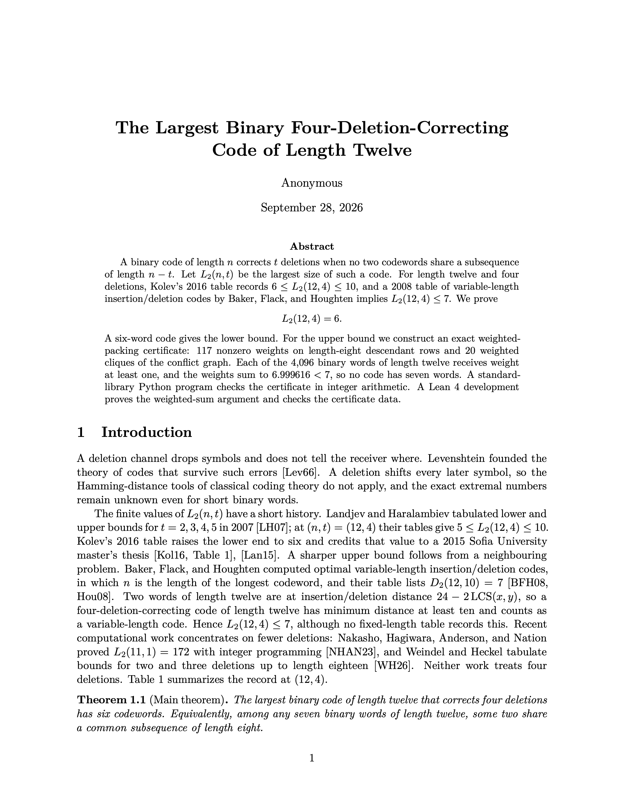
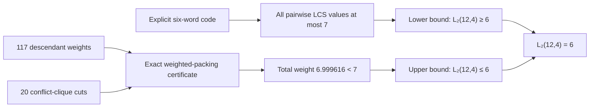
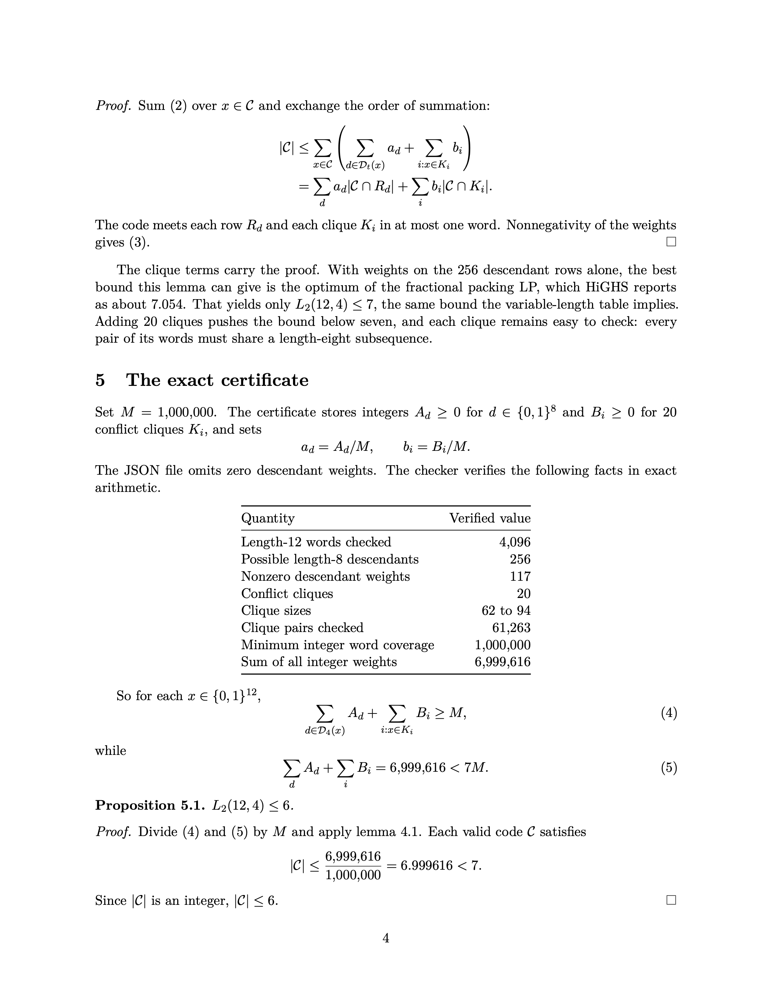

# The largest binary four-deletion code of length twelve

This project solves a small coding theory problem about sending information when some data gets lost. A bit is just a 0 or a 1, so a 12-bit binary string is a sequence of 12 zeros and ones, like 101100101011. In this problem, up to 4 of those bits can disappear during transmission, and the goal is to choose a group of 12-bit strings that can still be told apart even after those deletions happen. Before this result, researchers knew the largest possible group had either 6 or 7 strings. This paper proves that the exact answer is 6: it gives six strings that work, then proves that any group of seven must contain two strings that could become the same after four bits are deleted.


An explicit construction, exact weighted-packing certificate, independent
checkers, and Lean 4 formalization establishing

$$
\boxed{L_2(12,4)=6}.
$$

Here, $L_2(n,t)$ is the largest binary length-$n$ code whose codewords remain
distinguishable after exactly $t$ ordered deletions.

<p align="center">
  <a href="paper/exact-binary-four-deletion-code-length-12.pdf">
    
  </a>
</p>

<p align="center"><em>Click the preview to read the complete eight-page paper.</em></p>

## Proof at a glance



The lower bound is witnessed by the code

```text
000000000000
000011111110
010101010101
101111100000
110000000111
111111111111
```

The upper bound is certified by nonnegative rational weights covering every
binary word of length 12 while having total weight strictly below 7. Since a
valid code has integral cardinality, it can contain at most six words.

| Certificate fact | Exact value |
|---|---:|
| Length-12 words covered | 4,096 |
| Possible length-8 descendants | 256 |
| Nonzero descendant weights | 117 |
| Additional conflict cliques | 20 |
| Clique pairs checked | 61,263 |
| Integer denominator | 1,000,000 |
| Total integer weight | 6,999,616 |

<p align="center">
  <a href="paper/exact-binary-four-deletion-code-length-12.pdf">
    
  </a>
</p>

## Repository map

| Path | Contents |
|---|---|
| [`paper/`](paper/) | Compiled paper, LaTeX source, bibliography, and build notes |
| [`formalization/`](formalization/) | Complete runnable Lean project, certificate, Python checkers, and search code |
| [`lean/`](lean/) | Quick links to the main theorem and generated Lean data |
| [`archive/`](archive/) | Downloadable reproducibility bundle |
| [`assets/`](assets/) | Rendered paper previews used by this README |

The main theorem is
[`binary_length12_four_deletion_exact`](formalization/DeletionCodes/Conjectures/DeletionCode124.lean#L258).
The complete exact certificate is stored in
[`upper_certificate.json`](formalization/research/deletion_code_attempt/proof/upper_certificate.json).

## Reproduce the result

The Python verification uses only the standard library:

```bash
cd formalization
python3 research/deletion_code_attempt/verify_code.py
python3 research/deletion_code_attempt/proof/verify_upper_certificate.py
python3 research/deletion_code_attempt/proof/test_upper_certificate_mutations.py
```

Expected final markers:

```text
VERIFICATION=PASS
UPPER_CERTIFICATE=PASS
MUTATION_AUDIT=PASS
```

Build the focused Lean theorem and then the entire project:

```bash
cd formalization
lake build DeletionCodes.Conjectures.DeletionCode124
lake build
```

Build the manuscript with [Tectonic](https://tectonic-typesetting.github.io/):

```bash
cd paper
tectonic main.tex
```

## Verification boundary

The generic weighted-sum implication is proved in Lean. Four finite leaf
checks currently use `native_decide`, so the Lean artifact inherits the trust
boundary of Lean's native compiler and runtime. The repository does not claim
that this version is kernel-only or SafeVerify-compatible. The independent
Python checker reconstructs and verifies the certificate using exact integer
arithmetic.

## Literature status

A 2016 table by Emil Kolev records $6\leq L_2(12,4)\leq10$. A 2008 table of
optimal variable-length insertion/deletion codes by Baker, Flack, and Houghten
lists $D_2(12,10)=7$, and since two length-12 words are at insertion/deletion
distance $24-2\,\mathrm{LCS}$, that value implies $L_2(12,4)\leq7$. The
contribution here is the certified upper bound 6, one below the implied bound.
Searches through September 28, 2026 found no earlier exact determination or
upper bound below 7; the paper does not claim unconditional priority.

- [E. Kolev, *Optimal binary t-deletion-correcting codes* (2016)](https://www.math.bas.bg/~smb/2016_PK/tom_2016/pdf/135-139.pdf)
- [I. Landjev and K. Haralambiev, *On multiple deletion codes* (2007)](https://serdica-comp.math.bas.bg/index.php/serdicajcomputing/article/view/sjc.2007.1.13-26)
- [S. Houghten, *Optimal insertion-deletion correcting codes* (table, 2008)](https://www.cosc.brocku.ca/~houghten/insdel.html)
